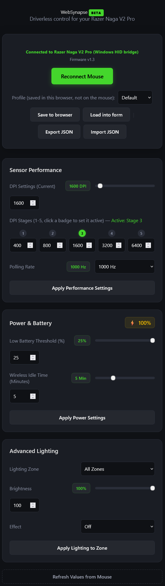

# WebSynapse

**Driverless configuration tool for the Razer Naga V2 Pro on Windows.**

WebSynapse talks directly to the mouse through a small local Windows HID bridge — no Razer Synapse install required.

**Created by [CheekyEntity](https://github.com/CheekyEntity)**

> ⚠️ **Unofficial tool.** This is a community project, not made or endorsed by Razer. It runs entirely on your machine (nothing is sent anywhere), and the full source is in this repo if you want to check what it's doing before you run it.

## Quick look



## Supported device

- **Razer Naga V2 Pro** only
- USB vendor ID `0x1532`, product IDs `0x00A7` (wired) and `0x00A8` (wireless/HyperSpeed receiver)

## Prerequisites

Before you start, make sure you have:

| Requirement | Notes |
|---|---|
| **Windows 10 or 11** | The native bridge uses the Windows HID API directly. |
| **[Node.js](https://nodejs.org/)** (v18 or later recommended) | Runs the local server. Check with `node -v`. |
| **PowerShell 7+ (`pwsh.exe`)** | The bridge script needs the `pwsh` command specifically — Windows' built-in PowerShell 5.1 (`powershell.exe`) is **not** enough. Install with:<br>`winget install --id Microsoft.PowerShell -e`<br>Then restart your terminal and check with `pwsh -v`. |
| **Naga V2 Pro connected** | By USB cable, or its wireless dongle. |

## Setup

1. **Download this project.**
   Clone it, or download and unzip it from GitHub.

2. **Open a terminal in the project folder.**
   In File Explorer, open the WebSynapse folder, then right-click → *Open in Terminal* (or `cd` there manually).

3. **Start the server:**
   ```
   node server.js
   ```
   You should see `WebSynapse is running at http://localhost:8000`.

4. **Open the app.**
   Go to [http://localhost:8000](http://localhost:8000) in Edge, Chrome, or another Chromium-based browser.
   > Opening `index.html` directly as a `file://` page will **not** work — it needs to be served by `node server.js` so the HID bridge can run.

5. **Click "Connect Mouse."**
   No browser device-picker step is needed — the local bridge handles the connection for you.

6. **Stop the server** whenever you're done by pressing `Ctrl+C` in the terminal.

## Troubleshooting

**`Could not start the Windows HID bridge: spawn pwsh.exe ENOENT`**
PowerShell 7 isn't installed, or isn't on your `PATH`. Install it with `winget install --id Microsoft.PowerShell -e`, restart your terminal, and try again.

**Browser shows a `NotAllowedError` when connecting**
This is expected on its own — Chromium blocks feature-report writes to protected mouse HID collections. That's exactly why the local Windows bridge exists; make sure `node server.js` is running and you're using `http://localhost:8000`, not opening the HTML file directly.

**"No writable Naga V2 Pro HID feature interface was found"**
- Confirm the mouse is connected (cable or wireless dongle) and powered on.
- Check it's recognized in Windows Device Manager.
- Try unplugging/reconnecting, or restarting the server.

**Port 8000 is already in use**
Set a different port before starting the server:
```
set WEBSYNAPSE_PORT=8080
node server.js
```
Then open `http://localhost:8080` instead.

**Mouse disconnects unexpectedly**
Click **Reconnect Mouse** — WebSynapse detects disconnects automatically and shows this button.

## Features

### Sensor Performance
- **DPI** — Read and set the current DPI (100–30,000)
- **DPI Stages** — Configure five DPI presets; click a stage's badge to choose which one is active
- **Polling Rate** — 125 / 500 / 1000 Hz
- **Firmware Version** — Shown next to the connection status once connected

### Power & Battery
- **Live Battery Level** with automatic refresh every 60 seconds
- **Charging Status** detection
- **Low Battery Threshold** — Configure warning percentage
- **Wireless Idle Time** — Set sleep timeout (1–15 min)
- **Charge Effect & Color** — Customize LED behaviour while charging (wireless connection only — hidden over a wired connection, since the mouse doesn't support it)

### Advanced Lighting
- **Independent zone control** — Logo LED, Main/Thumbgrid, or All Zones
- **Brightness** — 0–100%
- **Effects** — Off, Static, Breathing, Spectrum Cycling, Reactive, Wave
- **RGB colour picker** for colour-based effects

### Profiles
- **Save/Load Profiles** — Default, Gaming, and Work presets, saved in this browser only (not on the mouse)
- **Export/Import JSON** — Share profiles across browsers and machines

## How it works

WebSynapse constructs 90-byte Razer feature reports in JavaScript. The local bridge adds the Windows report-ID byte, communicates with the Naga through the Windows HID API, and returns the response to the page. The command protocol was reverse-engineered from the [OpenRazer](https://github.com/openrazer/openrazer) Linux driver.

Key implementation details:

- **Transaction ID**: `0x1F` for essentially every command this device accepts — checked against OpenRazer's reference driver across DPI, polling rate, battery, charging, idle time, and lighting
- **Response validation**: every command is sent and then read back, checking the device's status byte (success/busy/failure/timeout/not-supported) and that the response actually echoes the command class/id that was sent, instead of assuming a write succeeded
- **Charging LED controls**: only available on the wireless connection, matching the reference driver (the wired variant doesn't support them)
- **Checksum**: XOR of bytes 2–87, stored at byte 88
- **Command interface**: The bridge selects the Naga mouse collection with the 91-byte Windows feature report, after confirming it with a live protocol probe (not just matching HID descriptor metadata)
- **Session token**: the server generates a random token on startup and injects it into the page; every request to the local HID bridge must carry it, so another tab or website on your machine can't silently drive the mouse by hitting `localhost:8000` directly

## Project structure

```
WebSynapse/
├── docs/
│   └── UI.png             # Screenshot used in this README
├── index.html             # UI layout
├── styles.css              # Dark Razer-themed styling
├── app.js                  # Razer protocol and UI logic
├── server.js               # Local server and bridge API
├── native-bridge.ps1       # Windows HID implementation
└── README.md               # This file
```

## Credits

- Protocol research based on [OpenRazer](https://github.com/openrazer/openrazer) (GPL-2.0)
- Original browser API approach based on [WebHID](https://wicg.github.io/webhid/)

## License

[MIT](LICENSE)
